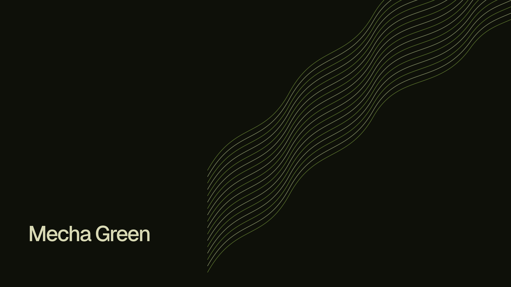
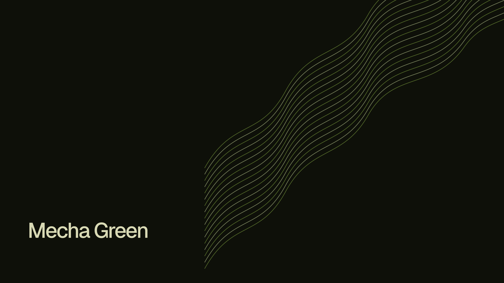
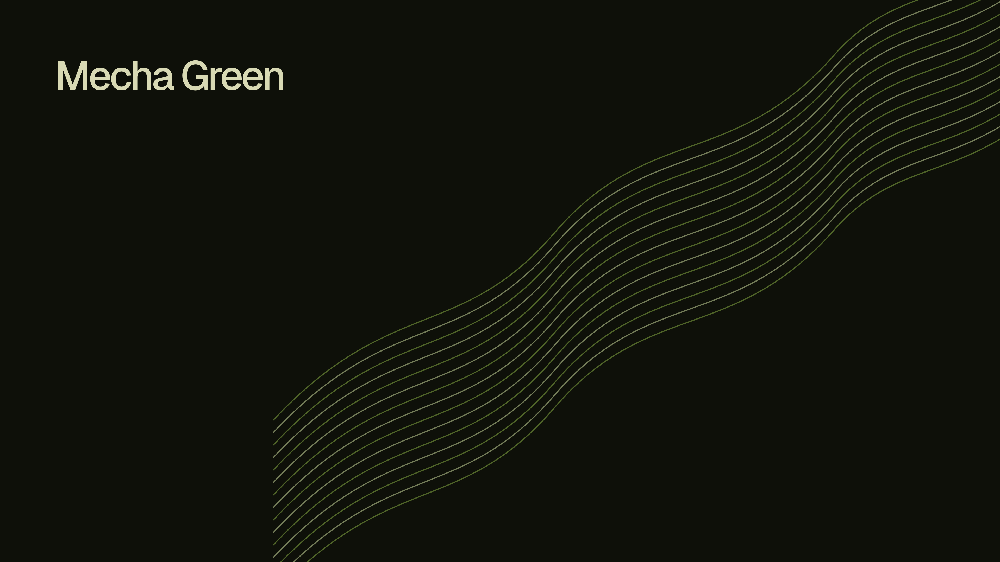
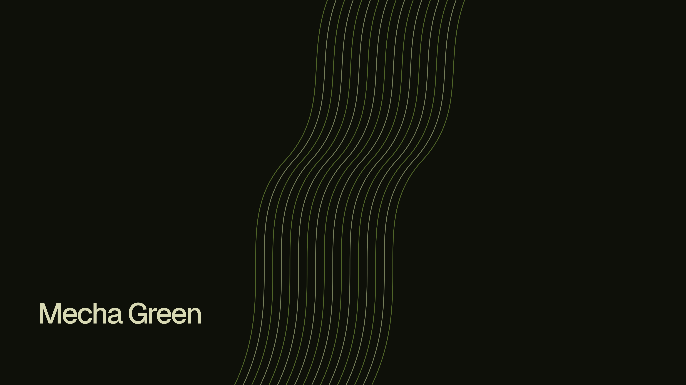
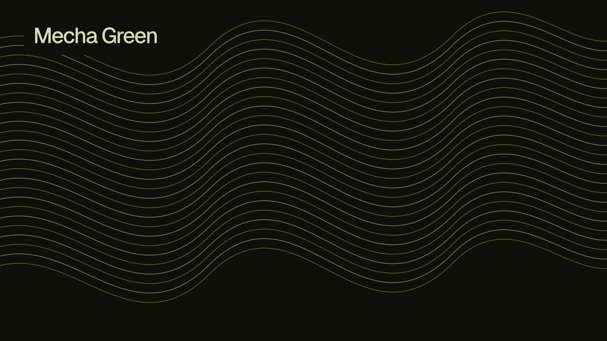
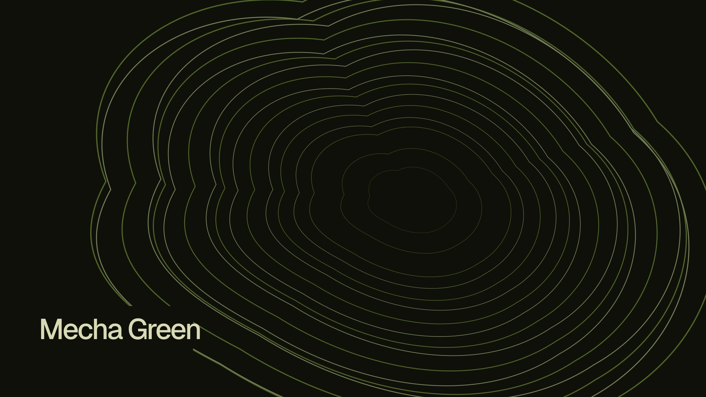
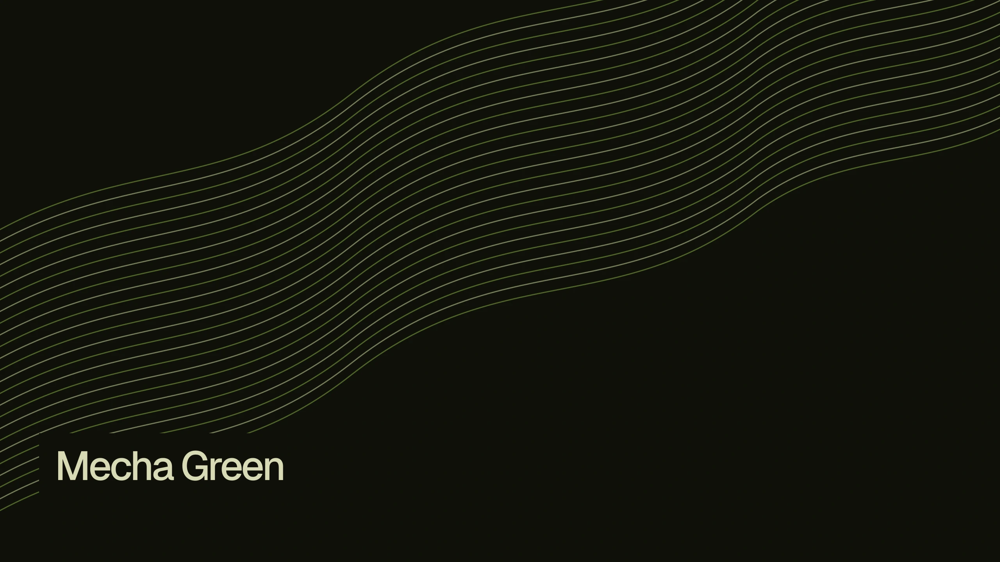
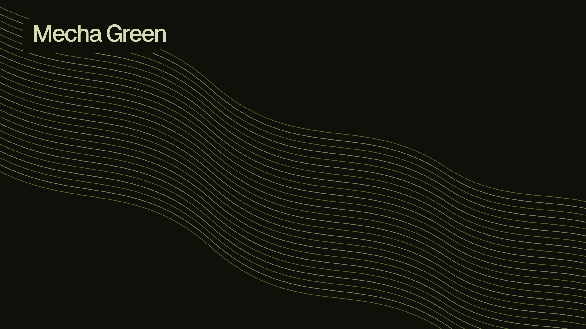

# Mecha Green



Military olive, visor amber and worn steel for Omarchy. Inspired by Halo's
Master Chief and the MCHOSE Ace 75 Mecha Green keyboard.

## Install

From this repository:

```sh
omarchy theme install https://github.com/sazardev/omarchy-mecha-green-theme
```

Once the registry listing is live, the short form is:

```sh
omarchy theme install mecha-green
```

The marketplace install keeps the palette, shell surfaces, btop, Chromium,
icons, keyboard RGB, unlock art and wallpapers. Omarchy regenerates the
terminal and Hyprland configs from `colors.toml`, so a theme installed from a
repository stays colours-only.

## Palette

| Role | Hex |
|---|---|
| Background | `#0E1009` |
| Raised surface | `#11150B` |
| Military olive | `#9DAE5C` |
| Visor amber / accent | `#F2C84B` |
| Sand text | `#D8D9B4` |
| Sage | `#BCC09A` |
| Rust | `#C85B47` |
| HUD teal | `#7FA89A` |

The theme sets `mode = "dark"` and styles the bar, menus, notifications,
launcher, OSD, lock screen, btop, Chromium, Neovim, Helix and the terminal
through Omarchy's normal palette generation.

## Wallpapers

Seven original flat stills and six clean live loops, licensed MIT together with
the theme:

| | |
|---|---|
| <br>**Default Wave** — the default brand wallpaper |
| <br>**Drift** — wide diagonal contours |
| <br>**Fold** — vertical contour folds |
| <br>**Field** — full-screen horizontal contours |
| <br>**Terrain** — full-screen nested contours |
| <br>**Panorama** — full-bleed diagonal wave |
| <br>**Undulate** — full-screen low wave |

`0-topographic.webp` sorts first and remains the default. The `100-` series
avoids collisions with optional Halo wallpapers. Each of the six new designs
also has an 8-second H.264 live loop with animated lines and fixed typography.

## Included

- `colors.toml` — the full dark palette and `mode = "dark"`.
- `shell.toml` — olive-black appbar, amber indicators, gradient borders,
  amber-tinted menus, launcher, lock screen and 28 px bar.
- `btop.theme`, `chromium.theme`, `icons.theme` (`Yaru-olive`) and
  `keyboard.rgb`.
- `unlock.png` and `preview-unlock.png` — amber Omarchy mark on dark olive.
- `preview.png` — 16:9 theme preview.
- `backgrounds/` — seven flat stills and six live loops, with
  `0-topographic.webp` as the default.

## Full project

The companion repository
[`sazardev/omarchy-mecha-green`](https://github.com/sazardev/omarchy-mecha-green)
adds:

- **Mecha Green Light**, a sand/bronze daylight twin.
- **Mecha HUD** and **Mecha NET** bar widgets with latency, CPU, RAM and
  battery telemetry.
- `mecha-status`, `mecha-themetize`, `mecha-livewall` and the optional
  Halo/military wallpaper fetcher with curated Spartans, UNSC, Covenant and
  Forerunner sets, plus the filtered Halo live loops.
- **SDDM login** and **Plymouth boot** themes plus lock-screen previews.
- The two-theme `install.sh` for the complete setup.

## Login and boot screens (optional)

Install the matching flat SDDM login and Plymouth splash without cloning the
full project:

```sh
sudo bash -c "$(curl -fsSL https://raw.githubusercontent.com/sazardev/omarchy-mecha-green/main/system/install-login.sh)"
```

The installer backs up the current configuration and rebuilds the initramfs.
The login appears after logout/reboot; the Plymouth splash appears on the next
boot. Requires `git`, SDDM and Plymouth.

## License

Theme configuration and original artwork are MIT. See [LICENSE](LICENSE).

Halo, Master Chief, MCHOSE and Omarchy are trademarks of their respective
owners. This is a personal fan theme, not affiliated with or endorsed by
Microsoft, 343 Industries, MCHOSE or Omarchy.
